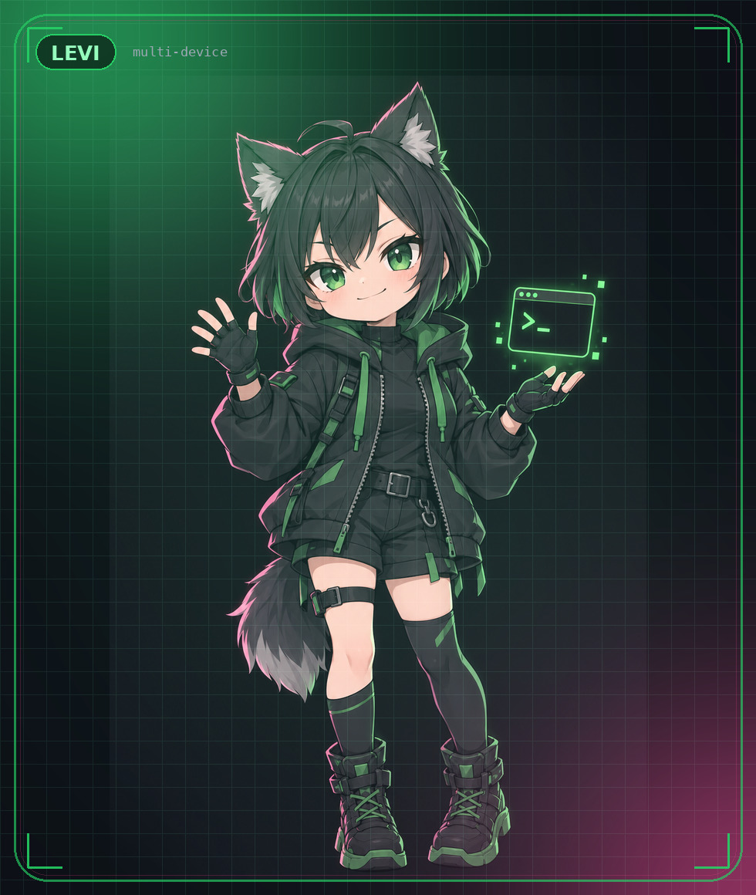

<div align="center">



<br>



<br>

[)](https://github.com/brayanflores29925-ctrl/Levi-MD)


<sub>

**[Instalar](#-instalación-en-5-minutos)** ·
**[Comandos](#-los-212-comandos)** ·
**[Botones](#-botones-y-el-aviso-actualizar-whatsapp)** ·
**[Arte](#-arte-del-bot)** ·
**[Problemas](#-si-algo-no-funciona)** ·
**[Guía cero-JS](LEEME-BRAYAN.md)**

</sub>

</div>

---

## 🧩 Qué es esto

Un bot de WhatsApp que se vincula como **dispositivo secundario** —sin API
oficial, sin cuenta de empresa, sin tarjeta— con **212 comandos**: menús con
botones nativos, economía con base de datos, gacha, stickers, descargas
(YouTube, TikTok, Instagram, Spotify…) y moderación de grupos.

Corre sobre el núcleo de **[Shin-MD](https://github.com/riokuroxi-svg/Shin-MD)**
de **riokuroxi-svg**, que aporta el motor anti-ban, la cola de envío y la base de
comandos. Este repositorio le pone la marca Levi, el arte y los arreglos de
abajo.

| | |
|---|---|
| **Comandos** | 212 únicos · 751 nombres con alias · 18 categorías |
| **Pruebas** | 181/182 pruebas (182 con `better-sqlite3`) |
| **Node** | ≥ 22.5 |
| **Datos** | SQLite con respaldo JSON automático |
| **Licencia** | AGPL-3.0-only |

## ⚡ Instalación en 5 minutos

```bash
git clone https://github.com/brayanflores29925-ctrl/Levi-MD
cd Levi-MD
npm install
cp .env.example .env
npm start
```

1. En `.env` pon **tu número personal** en `OWNER_NUMBER` (solo dígitos, sin `+`).
2. `npm start` imprime un **código de 8 dígitos**.
3. En el teléfono del bot: **Ajustes → Dispositivos vinculados → Vincular un
   dispositivo → Vincular con número de teléfono**.
4. Escríbele `.menu` desde tu número.

<details>
<summary><b>📱 Termux (Android) y dejarlo siempre encendido</b></summary>

```bash
pkg update && pkg install nodejs-lts git ffmpeg
git clone https://github.com/brayanflores29925-ctrl/Levi-MD && cd Levi-MD
npm install && cp .env.example .env && npm start
```

```bash
npm install -g pm2
pm2 start index.js --name levi && pm2 save
pm2 logs levi        # ver qué pasa
pm2 restart levi     # reiniciar
```

⚠️ Usa un **número secundario**. Ningún bot es inmune a un ban: la diferencia es
cuánto tarda en pasar.

</details>

## 🎛️ Configuración que importa

Todo vive en `.env`. Estas son las claves que de verdad cambian el comportamiento:

| Variable | Por defecto | Para qué |
|---|---|---|
| `OWNER_NUMBER` | — | **Tu** número (el dueño). Sin esto el bot no reconoce a nadie |
| `OWNERS` | — | Segundo dueño, separado por coma. Los dos mandan |
| `OWNER_NAME` | `Levi-Bot` | Nombre que sale en `.owner` |
| `PAIRING_METHOD` | `code` | `code` (8 dígitos) o `qr` |
| `WA_SAFE_MODE` | `1` | **Déjalo en 1**: degrada a texto lo que los WhatsApp viejos no pintan |
| `WA_ALLOW_TIPOS` | vacío | Permite tipos riesgosos concretos: `eventMessage,albumMessage` |
| `WA_BOT_NODE` | `0` | Marca los mensajes como «de un bot de IA». Encendido rompe clientes viejos |
| `RICH_EXTRA` | `0` | Trucos estéticos. **Señal detectable: riesgo de ban** |
| `MENU_IMAGE` / `MENU_VIDEO_PATH` | — | Fuerza la imagen o el vídeo del menú |
| `BOT_PREFIX` | `./#!/` | Prefijos aceptados |
| `LOG_LEVEL` | `info` | `debug` muestra todo |
| `PORT` / `PANEL_PASSWORD` | `3000` / — | Panel web. Si lo expones fuera de `127.0.0.1`, la contraseña es obligatoria |

## 📚 Los 212 comandos

Escribe `.menu` dentro de WhatsApp. Los imprescindibles:

| Comando | Qué hace |
|---|---|
| `.menu` / `.menucat` / `.allmenu` | menú con botones nativos, por categorías y completo |
| `.ping` | latencia de cola y socket |
| `.diag` | **diagnóstico**: cómo te ve WhatsApp, si te reconoce como dueño y estado del guardián |
| `.diag botones` | manda una tarjeta de prueba y avisa si el envío salió |
| `.setpfp` · `.setname` · `.setstatus` · `.setchannel` | foto, nombre, bio y canal del bot (solo dueño) |
| `.play` · `.tiktok` · `.instagram` · `.spotify` | descargas con audio, vídeo y portada |
| `.daily` · `.work` · `.banco` · `.casino` | economía con base de datos |

<details>
<summary><b>👑 Lo que puede hacer el dueño</b></summary>

`.setpfp` (foto, respondiendo a una imagen) · `.setname Corto/Largo` ·
`.setstatus` · `.setchannel <enlace>` · `.setprefix` · `.self` (modo self) ·
`.restart` · `.setowner` · `.update` · `.subir` · `.exec`

</details>

El catálogo completo, generado desde el propio bot (nombres, alias y
descripción reales de cada comando):

<details>
<summary><b>⚙️ Núcleo</b> · 7 comandos</summary>

| Comando | Alias | Qué hace |
|---|---|---|
| `.cache` | `limpiarcache`, `clearcache` | Ver y limpiar la caché del bot (temp, yt-dlp, play/mp3). |
| `.health` | `statsbot`, `salud` | Ver la salud del bot (RAM, uptime, yt-dlp/ffmpeg y errores recientes). |
| `.infobot` | `botinfo` | Obtener información del bot. |
| `.invite` | `invitar` | Invitar el bot a un grupo. |
| `.report` | `reporte`, `sug`, `suggest` | Enviar una sugerencia a los moderadores. |
| `.status` | `estado` | Ver el estado del bot. |
| `.warmup` | `tope`, `limite`, `limit` | Muestra el tope diario de mensajes del warm-up anti-ban |

</details>

<details>
<summary><b>👑 Dueño</b> · 8 comandos</summary>

| Comando | Alias | Qué hace |
|---|---|---|
| `.diag` | `quien`, `quiensoy`, `diagnostico` | Explica cómo ve WhatsApp al remitente y si el bot lo reconoce como dueño. |
| `.ex` | `e` | Ejecutar código JavaScript en el bot. |
| `.fix` | `update` | Actualizar y recargar los comandos del bot. |
| `.r` | — | Ejecutar comandos del sistema. |
| `.restart` | — | Reiniciar el socket del bot. |
| `.setmenu` | `menuvariant`, `menustyle`, `cambiarmenu` | Configura el estilo visual y la variante activa del menú principal |
| `.subir` | `upload`, `escribir` | Escribe/actualiza un archivo del bot sin tocar Termux |
| `.subircookies` | `cookies`, `ytcookies` | Sube tu cookies.txt de YouTube enviándolo como documento |

</details>

<details>
<summary><b>🔌 Socket / dueño</b> · 18 comandos</summary>

| Comando | Alias | Qué hace |
|---|---|---|
| `.bots` | `sockets` | Ver el número de bots activos. |
| `.code` | `qr`, `serbot`, `jadibot` | Gestionar y vincular subbots por código o QR. |
| `.join` | `unir` | Unir el bot a un grupo. |
| `.leave` | `salir` | Salir de un grupo. |
| `.logout` | — | Cerrar sesión del bot. |
| `.reload` | — | Recargar la sesión del bot. |
| `.self` | — | Hacer privado o público tu bot. |
| `.setbanner` | `setbotbanner` | Cambiar el banner del menú. |
| `.setbotcurrency` | `setcurrency` | Cambiar la moneda del bot. |
| `.setbotname` | `setname` | Cambiar el nombre del bot. |
| `.setbotowner` | `setowner` | Cambiar el dueño del bot. |
| `.setchannel` | `setbotchannel` | Cambiar el canal del bot. |
| `.seticon` | `setboticon` | Cambiar el ícono del bot. |
| `.setimage` | `setpfp` | Cambiar la imagen de perfil del bot. |
| `.setlink` | `setbotlink` | Cambiar el enlace del bot. |
| `.setprefix` | `setbotprefix` | Cambiar el prefijo del bot. |
| `.setstatus` | — | Cambiar el estado del bot. |
| `.setusername` | — | Cambiar el nombre de usuario del bot. |

</details>

<details>
<summary><b>💡 Información</b> · 8 comandos</summary>

| Comando | Alias | Qué hace |
|---|---|---|
| `.allmenu` | `fullmenu`, `am`, `comandos`, `allcommands` | Muestra la lista completa de todos los comandos organizados por categorías |
| `.demo` | `showcase`, `carousel`, `reels`, `demostracion` | Muestra la suite estética e interactiva de Shin-MD 🎠 |
| `.menu` | `help`, `ayuda`, `h`, `menupanel` | Muestra el menú interactivo principal de Levi-MD |
| `.menucat` | `mc`, `category`, `cat` | Muestra los comandos de una categoría con estilo enriquecido |
| `.owner` | `creator`, `creador`, `padre` | Muestra al owner del bot |
| `.ping` | `p` | Mide la latencia y muestra el estado del bot |
| `.runtime` | `uptime` | Estado y tiempo de actividad del bot |
| `.terminos` | `terms`, `licencia` | Términos de licencia (AGPL-3.0) y atribución |

</details>

<details>
<summary><b>💰 Economía</b> · 29 comandos</summary>

| Comando | Alias | Qué hace |
|---|---|---|
| `.adventure` | `aventura` | Ir de aventuras para ganar coins. |
| `.apostar` | `casino` | Apostar coins en el casino. |
| `.balance` | `bal`, `coins`, `bank` | Ver cuantos coins tienes. |
| `.cazar` | `hunt` | Cazar animales para ganar coins. |
| `.cf` | `flip`, `coinflip` | Apostar coins en un cara o cruz. |
| `.cofre` | `coffer` | Reclamar tu cofre diario. |
| `.crime` | `crimen` | Ganar coins rápido. |
| `.daily` | `diario`, `recompensa`, `gratis` | Reclamar tu recompensa diaria. |
| `.dep` | `deposit`, `d`, `depositar` | Depositar tus coins en el banco. |
| `.dungeon` | `mazmorra` | Explorar mazmorras para ganar coins. |
| `.economyboard` | `eboard`, `baltop` | Ver el ranking de usuarios con más coins. |
| `.givecoins` | `pay`, `coinsgive` | Dar coins a un usuario. |
| `.heal` | `curar`, `pocion`, `potion` | Curar salud para salir de aventuras. |
| `.infoeconomy` | `cooldowns`, `economyinfo`, `einfo` | Ver tu información de economía y cooldowns. |
| `.math` | `mates` | Iniciar un juego de matemáticas. |
| `.mine` | `minar`, `excavar` | Realizar trabajos de minería y ganar coins. |
| `.monthly` | `mensual` | Reclamar tu recompensa mensual. |
| `.pescar` | `fish` | Ganar coins pescando. |
| `.ppt` | — | Jugar piedra, papel o tijera con el bot. |
| `.ritual` | `invoke`, `invocar` | Hacer ritos de invocación. |
| `.robar` | `steal`, `rob` | Intentar robar coins a un usuario. |
| `.rt` | `roulette`, `ruleta` | Apostar coins en una ruleta. |
| `.shop` | `tienda`, `buy`, `comprar`, `inventory`, `inv`, `inventario` | Ver la tienda del bot. |
| `.slot` | — | Apostar coins en el casino. |
| `.slut` | `prostituirse` | Ganar coins con trabajos de riesgo. |
| `.transfer` | `transferir`, `enviarcoins` | Transferir monedas 💸 |
| `.w` | `work`, `chambear`, `trabajar` | Ganar coins trabajando. |
| `.weekly` | `semanal` | Reclamar tu recompensa semanal. |
| `.withdraw` | `with`, `retirar` | Retirar tus coins del banco. |

</details>

<details>
<summary><b>🎴 Gacha</b> · 24 comandos</summary>

| Comando | Alias | Qué hace |
|---|---|---|
| `.buyc` | `buycharacter`, `buychar` | Comprar un personaje en venta. |
| `.charimage` | `waifuimage`, `cimage`, `wimage` | Ver una imagen aleatoria de un personaje. |
| `.charinfo` | `winfo`, `waifuinfo` | Ver información de un personaje. |
| `.claim` | `c`, `reclamar` | Reclamar un personaje. |
| `.delchar` | `deletewaifu`, `delwaifu` | Eliminar un personaje reclamado. |
| `.delclaimmsg` | `resetclaimmsg` | Restablecer el mensaje al reclamar un personaje. |
| `.deletefav` | `delfav` | Borrar tu claim favorito. |
| `.favtop` | `favoritetop`, `favboard` | Ver el top de personajes favoritos. |
| `.gachainfo` | `ginfo`, `infogacha` | Ver tu información de gacha. |
| `.giveallharem` | — | Regalar todos tus personajes a otro usuario. |
| `.givechar` | `givewaifu`, `regalar` | Regalar un personaje a otro usuario. |
| `.harem` | `waifus`, `claims` | Ver tus personajes reclamados. |
| `.removesale` | `removerventa` | Eliminar un personaje en venta. |
| `.robwaifu` | `robarwaifu` | Robar un personaje a otro usuario. |
| `.rollwaifu` | `rw`, `roll` | Waifu o husbando aleatorio. |
| `.sell` | `vender` | Poner un personaje a la venta. |
| `.serieinfo` | `ainfo`, `animeinfo` | Información de un anime. |
| `.serielist` | `slist`, `animelist` | Listar series del bot. |
| `.setclaim` | `setclaimmsg` | Modificar el mensaje al reclamar un personaje. |
| `.setfav` | `setfavourite` | Establecer tu claim favorito. |
| `.trade` | `intercambiar` | Intercambiar un personaje con otro usuario. |
| `.vote` | `votar` | Votar por un personaje para subir su valor. |
| `.waifusboard` | `waifustop`, `topwaifus`, `wtop` | Ver el top de personajes con mayor valor. |
| `.wshop` | `haremshop`, `tiendawaifus` | Ver los personajes en venta. |

</details>

<details>
<summary><b>🪪 Perfil</b> · 14 comandos</summary>

| Comando | Alias | Qué hace |
|---|---|---|
| `.afk` | — | Activar el modo ausente (AFK). |
| `.delbirth` | — | Borrar tu fecha de cumpleaños. |
| `.deldescription` | `deldesc` | Eliminar tu descripción de perfil. |
| `.delgenre` | — | Eliminar tu género del perfil. |
| `.delpasatiempo` | `removehobby` | Eliminar tu pasatiempo del perfil. |
| `.divorce` | — | Divorciarte de tu pareja. |
| `.lboard` | `lb`, `leaderboard` | Top de usuarios con más experiencia. |
| `.level` | `lvl`, `nivel`, `xp` | Ver tu nivel y experiencia actual con tarjeta gráfica. |
| `.marry` | `casarse` | Casarte con alguien. |
| `.profile` | `perfil` | Ver tu perfil con tarjeta gráfica personalizada de estadísticas. |
| `.setbirth` | — | Establecer tu fecha de cumpleaños. |
| `.setdescription` | `setdesc` | Establecer tu descripción de perfil. |
| `.setgenre` | — | Establecer tu género. |
| `.setpasatiempo` | `sethobby` | Establecer tu pasatiempo. |

</details>

<details>
<summary><b>👥 Grupos</b> · 27 comandos</summary>

| Comando | Alias | Qué hace |
|---|---|---|
| `.autotraducir` | `autotrad`, `autotr` | Traduce automáticamente al idioma que elijas lo que llegue en otro. |
| `.bot` | — | Activar o desactivar el bot en el grupo. |
| `.clear` | — | Limpiar usuarios inactivos del grupo. |
| `.close` | `cerrar` | Cerrar el grupo para que solo admins puedan enviar mensajes. |
| `.count` | `mensajes`, `messages`, `msgcount` | Obtener el conteo de mensajes de un usuario. |
| `.delwarn` | — | Eliminar una advertencia de un miembro del grupo. |
| `.demote` | `degradar` | Descender a un usuario de administrador. |
| `.gp` | `groupinfo` | Ver la información del grupo. |
| `.hidetag` | `tag` | Enviar un mensaje mencionando a todos los usuarios del grupo. |
| `.kick` | `ban`, `bang` | Expulsar a un usuario del grupo. |
| `.link` | — | Obtener el enlace del grupo. |
| `.open` | `abrir` | Abrir el grupo para que todos puedan enviar mensajes. |
| `.promote` | `promover` | Ascender a un usuario a administrador. |
| `.revoke` | `restablecer` | Restablecer el enlace del grupo. |
| `.setgoodbye` | — | Establecer un mensaje de despedida personalizado. |
| `.setgpbanner` | — | Cambiar la imagen del grupo. |
| `.setgpdesc` | — | Cambiar la descripción del grupo. |
| `.setgpname` | — | Cambiar el nombre del grupo. |
| `.setprimary` | — | Establecer un bot como primario del grupo. |
| `.setwarnlimit` | — | Establecer el límite de advertencias del grupo. |
| `.setwelcome` | — | Establecer un mensaje de bienvenida personalizado. |
| `.todos` | `tagall`, `mencionar` | Enviar un mensaje mencionando a todos los usuarios del grupo. |
| `.topcount` | `topmensajes`, `topmsgcount`, `topmessages` | Ver el top de usuarios con más mensajes en el grupo. |
| `.topinactive` | `topinactivos`, `topinactiveusers` | Ver el top de usuarios más inactivos del grupo. |
| `.warn` | — | Darle una advertencia a un miembro del grupo. |
| `.warns` | — | Ver todas las advertencias de un miembro del grupo. |
| `.welcome` | `bienvenida`, `goodbye`, `despedida`, `alerts`, `alertas`, `nsfw` | Configurar opciones del grupo. |

</details>

<details>
<summary><b>👥 Grupos (extra)</b> · 3 comandos</summary>

| Comando | Alias | Qué hace |
|---|---|---|
| `.evento` | `event`, `agendar` | Crea una tarjeta de evento nativa en el grupo |
| `.fijar` | `fijarmsg`, `desfijar`, `unpin`, `pinmsg` | Fija (o desfija) el mensaje al que respondes, arriba del grupo |
| `.guardar` | `keep`, `salvar`, `soltar`, `unkeep` | Rescata un mensaje temporal para que no se borre (o lo suelta) |

</details>

<details>
<summary><b>📥 Descargas</b> · 16 comandos</summary>

| Comando | Alias | Qué hace |
|---|---|---|
| `.apk` | `aptoide`, `apkdl` | Buscar y descargar aplicaciones de Aptoide. |
| `.deezer` | `dzr`, `deezermusic` | Buscar música en Deezer (preview de 30 segundos). |
| `.drive` | `gdrive` | Descargar un archivo de Google Drive. |
| `.fb` | `facebook` | Descargar un video de Facebook. |
| `.imagen` | `img`, `image` | Buscar y descargar imágenes de Google. |
| `.instagram` | `ig`, `reel` | Descargar un reel de Instagram. |
| `.mediafire` | `mf` | Descargar un archivo de MediaFire. |
| `.pinterest` | `pin` | Buscar y descargar imágenes de Pinterest (⚠️ servicio temporalmente fuera de línea). |
| `.play` | `yt`, `musica`, `music`, `mp3`, `ytmp3`, `ytaudio` | Busca, reproduce y descarga música/videos con botones interactivos y precalentado 🎵 |
| `.play2` | `mp4`, `playvideo`, `ytvideo`, `ytmp4`, `video` | Busca y descarga videos de YouTube en formato MP4 📹 |
| `.playsoundcloud` | `playsc`, `scplay`, `soundcloud`, `scdl` | Busca y descarga canciones desde SoundCloud ☁️ |
| `.spotify` | `sp`, `spot`, `spotifydl`, `spotplay`, `spdl` | Busca y descarga canciones de Spotify en formato MP3 🎵 |
| `.tiktok` | `tt` | Descargar un video de TikTok. |
| `.twitter` | `x` | Descargar un video/imagen de Twitter/X. |
| `.ytdlp` | `ytdl` | Descarga video/canciones con yt-dlp local (turbo + auto-update). |
| `.ytsearch` | `search`, `yts` | Buscar vídeos de YouTube (carrusel de resultados). |

</details>

<details>
<summary><b>🎨 Stickers</b> · 17 comandos</summary>

| Comando | Alias | Qué hace |
|---|---|---|
| `.addsticker` | `stickeradd` | Agregar un sticker a un paquete. |
| `.brat` | — | Crear un sticker estilo brat con texto. |
| `.bratv` | — | Crear un video-sticker estilo brat. |
| `.delmeta` | `delstickermeta` | Restablecer el pack y autor por defecto para tus stickers. |
| `.delpack` | — | Eliminar un paquete de stickers. |
| `.emojimix` | — | Mezclar dos emojis en un sticker. |
| `.getpack` | `pack`, `stickerpack` | Descargar un paquete de stickers. |
| `.newpack` | `newstickerpack` | Crear un nuevo paquete de stickers. |
| `.packlist` | `stickerpacks` | Listar tus paquetes de stickers. |
| `.qc` | — | Crear un sticker con texto estilo quote. |
| `.setpackprivate` | `setpackpriv`, `packprivate` | Establecer un paquete de stickers como privado. |
| `.setpackpublic` | `setpackpub`, `packpublic` | Establecer un paquete de stickers como público. |
| `.setstickermeta` | `setmeta` | Establecer el pack y autor por defecto para tus stickers. |
| `.setstickerpackdesc` | `setpackdesc`, `packdesc` | Establecer la descripción de un paquete de stickers. |
| `.setstickerpackname` | `setpackname`, `packname` | Cambiar el nombre de un paquete de stickers. |
| `.sticker` | `s` | Convertir una imagen o video a sticker. |
| `.stickerdel` | `delsticker` | Eliminar un sticker de un paquete. |

</details>

<details>
<summary><b>🖼️ Media</b> · 1 comando</summary>

| Comando | Alias | Qué hace |
|---|---|---|
| `.audioeffect` | `bass`, `nightcore`, `slow`, `robot`, `reverse`, `blown` | Aplica efectos de sonido a notas de voz o archivos de audio |

</details>

<details>
<summary><b>🛠️ Utilidades</b> · 23 comandos</summary>

| Comando | Alias | Qué hace |
|---|---|---|
| `.acortar` | `shorturl`, `shorten`, `acorta` | Acortar un enlace con TinyURL. |
| `.ai` | `ia`, `chatgpt`, `gemini`, `chat` | Chatear con la IA con memoria conversacional y formato Meta AI. |
| `.btc` | `crypto`, `precio` | Precio de criptomonedas (BTC, ETH, SOL...). |
| `.carbon` | `codigoimg`, `codeimg` | Convertir código en una imagen bonita (carbon). |
| `.deepseek` | `ds`, `deepthink`, `reasoning`, `r1` | Razonamiento lógico avanzado y programación con DeepSeek-R1 🧠 |
| `.encuesta` | `poll`, `votacion`, `quiz` | Crea una encuesta, un quiz con respuesta correcta o una votación de varias opciones. |
| `.get` | `fetch` | Realizar solicitudes GET a páginas web. |
| `.gitclone` | `git` | Buscar y descargar un repositorio de GitHub. |
| `.githubstalk` | `ghstalk`, `gh` | Ver información de un usuario de GitHub. |
| `.hd` | `enhance`, `remini` | Mejorar la calidad de una imagen. |
| `.letra` | `lyrics`, `lyric` | Buscar la letra de una canción. |
| `.morse` | `demorse` | Convertir texto a código morse (y viceversa). |
| `.pfp` | `getpic` | Ver la foto de perfil de un usuario. |
| `.ptv` | `videoredondo`, `redondo`, `notavideo` | Convierte el video que respondes en un video redondo |
| `.qrcode` | `qrgen`, `makeqr` | Generar un código QR a partir de un texto o enlace. |
| `.readviewonce` | `read`, `readvo` | Convertir imagen/video de una vista a contenido. |
| `.recordar` | `recordatorio`, `reminder`, `alarma` | Programar un recordatorio en X minutos. |
| `.say` | `decir` | Repetir un mensaje como el bot. |
| `.toimg` | `toimage` | Convertir un sticker a imagen o GIF. |
| `.tourl` | — | Convertir una imagen/video/sticker respondido en un enlace. |
| `.translate` | `trad`, `traducir`, `tr` | Traduce un texto o el mensaje al que respondas. |
| `.tts` | `voz`, `decirvoz`, `speak` | Convierte texto a nota de voz con voz femenina en español. |
| `.wastalk` | `stalknum`, `numbstalk`, `perfilwa`, `infowa` | Ver información pública de un número de WhatsApp. |

</details>

<details>
<summary><b>🛠️ Utilidades (extra)</b> · 1 comando</summary>

| Comando | Alias | Qué hace |
|---|---|---|
| `.benchdl` | — | Prueba de velocidad de las APIs de descarga ⏱️ |

</details>

<details>
<summary><b>🌸 Anime</b> · 4 comandos</summary>

| Comando | Alias | Qué hace |
|---|---|---|
| `.angry` | `enojado`, `enojada`, `bleh`, `meh`, `bored`, `aburrido` | Comandos de reacciones de anime. |
| `.anime` | `anibusc` | Buscar información de un anime por AniList. |
| `.ppcp` | `ppcouple` | Generar imágenes para amistades o parejas. |
| `.waifu` | `neko` | Obtener una imagen de waifu aleatoria. |

</details>

<details>
<summary><b>🎮 Juegos</b> · 4 comandos</summary>

| Comando | Alias | Qué hace |
|---|---|---|
| `.adivina` | `guess`, `adivinar`, `numero` | Adivina el número del 1 al 100 🎯 |
| `.kuro` | `slash`, `kuroslash`, `reaccion` | Juego de reacción tipo KURO SLASH ⚔️ |
| `.trivia` | `preguntas`, `trivial` | Juego de preguntas y respuestas 🧠 |
| `.ttt` | `tresenraya`, `tateti` | Juega tres en raya con botones 🎮 |

</details>

<details>
<summary><b>🎲 Diversión</b> · 2 comandos</summary>

| Comando | Alias | Qué hace |
|---|---|---|
| `.chiste` | `dato`, `datointeresante`, `consejo`, `piropo`, `8ball`, `8bola` | Comandos divertidos: chistes, datos, piropos, bola 8, love, dado, moneda. |
| `.fax` | `facts`, `datos` | Dato curioso, frase y estado del bot con botones |

</details>

<details>
<summary><b>🔞 NSFW (+18)</b> · 6 comandos</summary>

| Comando | Alias | Qué hace |
|---|---|---|
| `.anal` | `violar`, `cum`, `undress`, `encuerar`, `fuck`, `coger` | Comandos de reacciones NSFW entre usuarios. |
| `.danbooru` | `dbooru` | Buscar imágenes en Danbooru. |
| `.gelbooru` | `gbooru` | Buscar imágenes en Gelbooru. |
| `.r34` | `rule34`, `rule` | Buscar imágenes en Rule34. |
| `.xnxx` | — | Buscar y descargar videos de XNXX. |
| `.xvideos` | — | Buscar y descargar videos de XVideos. |

</details>

## 🎛️ Botones y el aviso «Actualizar WhatsApp»

### Por qué sale ese aviso

No es un error del bot: es el **teléfono de quien recibe** diciendo que no sabe
dibujar ese tipo de mensaje. WhatsApp acepta el envío, así que a ti no te sale
ningún error y parece que «el mensaje no carga».

Tres cosas lo provocan:

1. **El nodo `bot`** (`biz_bot=1`): marca el mensaje como «de un bot de IA».
   Antes se metía en *todos* los chats privados.
2. **Tipos nuevos** que los clientes viejos no conocen: evento de calendario,
   álbum, tarjetas de IA…
3. **Botones del formato 2021** (`templateMessage` / `buttonsMessage`), retirados
   por WhatsApp.

### Cómo se arregló (de raíz, no comando por comando)

El arreglo no está en los comandos: está en **la única puerta por la que sale
todo mensaje** (`src/core/socket.js` → `src/lib/wa-guard.js`). Cada mensaje pasa
por el guardián, que:

- degrada a **texto plano** los tipos que rompen, **conservando el contenido**
  (un evento sale con fecha; una tarjeta, con su texto y sus botones escritos);
- **elimina el nodo `bot`** salvo que lo pidas explícitamente;
- **repara las tarjetas interactivas**: rellena `messageVersion` (sin él el
  teléfono las descarta), corrige cabeceras que declaran imagen y no la traen, y
  quita botones sin parámetros que invalidan toda la tarjeta;
- completa el nodo `quality_control` con `decision_id`, como el cliente oficial.

Se controla con `WA_SAFE_MODE` y `WA_ALLOW_TIPOS`. Además `.diag` te dice
**cuántos mensajes se degradaron y de qué tipo**.

<details>
<summary><b>Qué se manda hoy, mensaje por mensaje</b></summary>

| Mensaje | Estado | Nota |
|---|---|---|
| Tarjeta con botones (`quick_reply`, `cta_url`, `cta_copy`, `cta_call`) | ✅ | nativo, con respaldo a texto |
| Lista desplegable (`single_select` y lista clásica) | ✅ | |
| Carrusel de tarjetas | ✅ | |
| Tarjeta con imagen de cabecera | ✅ | |
| Encuestas (normal y tipo quiz) | ✅ | |
| Pin de mensaje | ✅ | |
| Álbum de fotos | ⚠️ | degradado a texto salvo `WA_ALLOW_TIPOS=albumMessage` |
| Evento de calendario | ⚠️ | ídem |
| Tarjeta enriquecida «IA» | ⚠️ | ídem |
| Añadir opción a encuesta viva | ❌ | el proto de `baileys@6.7.24` no lo trae |

Detalle técnico y comparativa con `@itsliaaa/baileys` y `whatsmeow`:
**[docs/BOTONES.md](docs/BOTONES.md)**.

</details>

## 🎨 Arte del bot

Todo el arte es propio y vive en el repositorio (nada de enlaces externos que se
rompan):

| Archivo | Dónde se ve |
|---|---|
| `assets/levi-mascota.png` | mascota del bot (avatar, menús) |
| `assets/levi-card.jpg` | tarjeta de presentación del README |
| `assets/imagenes/levi-banner.png` | banner del menú (día y noche) |
| `assets/imagenes/levi-menu-1..3.jpg` | rotación de imágenes de `.menu` / `.menucat` |
| `media/covers/levi-cover-1..3.jpg` | **portadas del `.play`** y del audio |
| `assets/imagenes/levi-avatar.jpg` | avatar por defecto del bot |

<div align="center">


&nbsp;&nbsp;&nbsp;

&nbsp;&nbsp;&nbsp;


</div>

<details>
<summary><b>Contador de visitas animado (estilo Moe Counter)</b></summary>

El contador con dibujos pixel-art que se ve en otros README **no se puede dejar
puesto aquí**: `count.getloli.com` está detrás de Cloudflare y GitHub lo sirve
como imagen rota. Si quieres tenerlo, pega esta línea al principio del README
(abajo del todo funciona igual) **y comprueba en GitHub que carga**:

```html

```

Temas disponibles: `green`, `moebooru`, `rule34`, `gelbooru`, `miku`, `asoul`,
`minecraft`… Cambia `green` por el que te guste y `@levi-md` por el nombre que
quieras (el contador es por nombre: si lo cambias, empieza de cero).

Alternativa que **sí** funciona siempre (sin dibujos, pero sin romperse):
`https://komarev.com/ghpvc/?username=brayanflores29925-ctrl&color=25D366`.

</details>

<details>
<summary><b>Cambiar el arte sin tocar código</b></summary>

- **Menú:** deja tus imágenes en `media/banners/` (se eligen por hora: `day` /
  `night`) o fuerza una con `MENU_IMAGE=/ruta/imagen.jpg` en `.env`.
- **Portadas del play:** reemplaza los archivos de `media/covers/` (se elige una
  al azar por canción) y la de respaldo `media/audio-cover.jpg`.
- **Imágenes del `.menucat`:** ponlas en `assets/imagenes/`.
- **Vídeo del menú:** `assets/video/levi-mp4.mp4` o `MENU_VIDEO_PATH` en `.env`.

</details>

## 🛡️ Anti-ban (heredado de Shin-MD)

Sin milagros, con parámetros concretos:

- **Jitter gaussiano** (Box-Muller, σ 0.25) sobre una base de **1200 ms**
  (rango 400–5000 ms, +25 ms por carácter).
- **Warm-up de 7 días**: de 20 a 500 mensajes/día.
- **×1.5** de espera a contactos nuevos.
- **Cola serial** con reintentos: nada se manda en paralelo.
- Reacciones, borrados y ediciones **no gastan** cuota diaria.

Esa combinación exacta es el **marcador de obra derivada** de Shin-MD descrito en
el `NOTICE`.

## 🗂️ Estructura

```
index.js · boot/          arranque, sesión, anti-crash
cmds/                     1 archivo = 1 comando (212)
src/core/                 motor anti-ban, auth, watchdog, socket
src/commands/             router, contexto, loader
src/lib/                  wa-guard, owner-check, wa-nodes, native-reply, tema…
src/storage/              SQLite + respaldo JSON
src/network/              cola de envío, health
assets/ imagenes/ media/  arte del bot
docs/                     BOTONES.md, PROCEDENCIA.md, web/
test/                     30 archivos, 182 pruebas
```

## 🔧 Si algo no funciona

<details>
<summary><b>«Este comando es solo para el owner del bot»</b></summary>

Manda `.diag`. Te dice cómo te ve WhatsApp (`@s.whatsapp.net`, `@lid`, con sufijo
`:12`), qué número tiene guardado y por qué no coincide.

Causa típica: `OWNER_NUMBER` con `+`, espacios, o es el número del bot en vez del
tuyo.

</details>

<details>
<summary><b>«Recibiste un mensaje que no es compatible con tu versión de WhatsApp»</b></summary>

Con `WA_SAFE_MODE=1` ya no debería pasar. Si pasa:

1. Revisa que no tengas `WA_BOT_NODE=1` ni `RICH_EXTRA=1`.
2. `.diag botones` → si la tarjeta de prueba llega, el motor está sano.
3. `.diag` → mira «mensajes degradados»: ahí sale el tipo culpable.

</details>

<details>
<summary><b>El bot se desconecta solo</b></summary>

```bash
pm2 logs levi --lines 100
```

Copia las últimas 30 líneas. No borres `data/`: ahí vive la sesión.

</details>

<details>
<summary><b>Un comando no existe</b></summary>

Puede estar en la rama `respaldo/levi-legacy`, que conserva los 382 comandos del
bot anterior que no se migraron a `main`.

</details>

## 🧪 Pruebas

```bash
npm test        # 181/182 pruebas (182 con better-sqlite3 instalado)
npm run lint
```

> `test/sqlite-respaldo.test.js` necesita `better-sqlite3`. Sin él el bot funciona
> con el respaldo JSON, pero esa prueba no puede ejecutarse.

## 📄 Licencia y atribución

**AGPL-3.0-only** · ver [LICENSE](LICENSE) y [NOTICE](NOTICE).

Este proyecto es una **obra derivada** de **Shin-MD** por **riokuroxi-svg**
([github.com/riokuroxi-svg/Shin-MD](https://github.com/riokuroxi-svg/Shin-MD)). El `NOTICE` se conserva sin
modificar y sus términos de la Sección 7 aplican: el crédito
«Basado en Shin-MD por riokuroxi-svg» aparece de forma permanente en `.menu` y
`.owner`, y las marcas `Shin-MD` y `反魂` quedan reservadas a su autor — este bot
no las usa como marca propia.

<div align="center">

---

<sub>Hecho para funcionar sin caerse · <b>Levi-MD</b><br>
base <a href="https://github.com/riokuroxi-svg/Shin-MD">Shin-MD</a> de riokuroxi-svg</sub>

</div>
